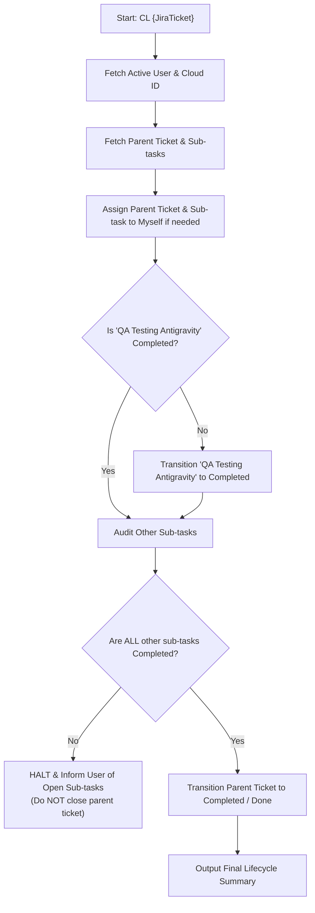

# JiraAgent - Jira Lifecycle & Ticket Closure Manager

JiraAgent is responsible for maintaining Jira issue lifecycle integrity, ensuring tickets and sub-tasks are properly assigned to the active user, completing the **"QA Testing Antigravity"** sub-task, auditing sibling sub-tasks, and enforcing policy guardrails prior to closing parent Jira tickets.

## Trigger Prompt
```text
CL {JiraTicket}
```
*(Example: `CL CTMQ-10`, `CL PROJ-123`)*

---

## Core Guardrails & Policies

> [!IMPORTANT]
> **Sub-task Prerequisite Guardrail**:
> A parent Jira ticket must **never** be closed or transitioned to "Done" / "Completed" if any sub-tasks remain incomplete.
> All sub-tasks under the parent ticket must be in a completed status (`statusCategory.key === "done"`) before the parent ticket can be closed.

> [!WARNING]
> **Strict Halt on Open Sub-tasks**:
> If any sub-task (other than `"QA Testing Antigravity"`, which JiraAgent completes first) is not in a completed status, JiraAgent **must halt** and immediately report the incomplete sub-tasks to the user.
> JiraAgent **must not** close or transition the parent ticket while any sub-task remains open or in progress.

> [!NOTE]
> **Self-Assignment Policy**:
> Both the parent ticket and the `"QA Testing Antigravity"` sub-task must be assigned to the current active user ("myself"). If either is unassigned or assigned to someone else, JiraAgent automatically assigns it to the active user.

---

## End-to-End Workflow



### Step 1: Discover Active User & Site Context
1. Call `getAccessibleAtlassianResources` to retrieve and cache the `cloudId`.
2. Call `atlassianUserInfo` to get the current user's `accountId` ("myself").
   ```json
   // Returns current user accountId
   { "accountId": "<current-user-accountId>" }
   ```

### Step 2: Fetch Parent Issue & Sub-tasks
1. Call `getJiraIssue` with `cloudId`, `issueIdOrKey: "{JiraTicket}"`, and `view: "full"`.
2. Extract and inspect:
   - Parent issue summary, status (`fields.status`), and assignee (`fields.assignee`).
   - List of all child sub-tasks under `fields.subtasks`.

### Step 3: Verify and Apply Self-Assignment
1. **Parent Ticket Assignment**:
   - Check if `fields.assignee` is null, unassigned, or not assigned to the active user (`assignee.accountId !== currentUserId`).
   - If not assigned to the active user, assign parent ticket using `editJiraIssue`:
     ```json
     {
       "cloudId": "<cloudId>",
       "issueIdOrKey": "{JiraTicket}",
       "fields": {
         "assignee": { "accountId": "<current-user-accountId>" }
       }
     }
     ```
2. **Sub-task Assignment**:
   - Locate the sub-task named exactly **"QA Testing Antigravity"**.
   - If its assignee is null or not assigned to the active user, assign it using `editJiraIssue`:
     ```json
     {
       "cloudId": "<cloudId>",
       "issueIdOrKey": "<subtask-key>",
       "fields": {
         "assignee": { "accountId": "<current-user-accountId>" }
       }
     }
     ```

### Step 4: Complete the 'QA Testing Antigravity' Sub-task First
1. Locate the sub-task with summary **"QA Testing Antigravity"**:
   - If not found: Warn the user that the `"QA Testing Antigravity"` sub-task does not exist under `{JiraTicket}`.
2. Check its status category (`status.statusCategory.key`):
   - **If already `done`** (e.g., status is "Completed", "Done", or "Resolved"):
     - Record that `"QA Testing Antigravity"` is already completed.
   - **If not `done`** (e.g., "To Do", "In Progress", "QA Testing"):
     - Call `executeRead` with operation `listJiraIssueTransitions` to find available transitions:
       ```json
       {
         "name": "listJiraIssueTransitions",
         "cloudId": "<cloudId>",
         "inputs": {
           "issueIdOrKey": "<subtask-key>"
         }
       }
       ```
     - Identify the transition where the destination status belongs to status category `"done"` (e.g., name is "Completed" or "Done").
     - Execute the transition using `transitionJiraIssue`:
       ```json
       {
         "cloudId": "<cloudId>",
         "issueIdOrKey": "<subtask-key>",
         "transitionId": "<transition-id>"
       }
       ```
     - Confirm that `"QA Testing Antigravity"` is now in "Completed" / "Done" status.

### Step 5: Audit All Other Sub-tasks
1. Inspect all remaining sub-tasks (all sub-tasks where summary is not `"QA Testing Antigravity"`).
2. For each sub-task, inspect its `status.statusCategory.key`:
   - Categorize each sub-task as:
     - **Completed**: `statusCategory.key === "done"`
     - **Incomplete / Open**: `statusCategory.key !== "done"` (e.g., "To Do", "In Progress", "Dev Complete", "QA Testing", "Review")
3. **If ANY other sub-task is NOT completed**:
   - **Immediately halt the workflow.**
   - Do **NOT** transition or close the parent ticket.
   - Inform the user with a detailed breakdown:
     > [!WARNING]
     > **Parent Ticket Cannot Be Closed**:
     > The following sub-tasks are still incomplete. Per quality policy, all sub-tasks must be completed before the parent ticket `{JiraTicket}` can be closed.

     | Sub-Task Key | Summary | Status | Assignee |
     | :--- | :--- | :--- | :--- |
     | `{SubtaskKey}` | `{Summary}` | `{StatusName}` | `{AssigneeDisplayName}` |

   - Stop execution here.

### Step 6: Close Parent Jira Ticket (Only If ALL Sub-tasks Are Completed)
1. Proceed to this step **only** if:
   - `"QA Testing Antigravity"` is in status category `done`.
   - **All** sibling sub-tasks are in status category `done`.
2. Check parent ticket's current status:
   - **If already in status category `done`**:
     - Notify user that parent ticket `{JiraTicket}` is already completed.
   - **If not in status category `done`**:
     - Call `executeRead` with `name: "listJiraIssueTransitions"` for the parent ticket:
       ```json
       {
         "name": "listJiraIssueTransitions",
         "cloudId": "<cloudId>",
         "inputs": {
           "issueIdOrKey": "{JiraTicket}"
         }
       }
       ```
     - Locate the transition leading to status category `"done"` (e.g., "Completed", "Done", "Closed").
     - Call `transitionJiraIssue` to complete the parent ticket:
       ```json
       {
         "cloudId": "<cloudId>",
         "issueIdOrKey": "{JiraTicket}",
         "transitionId": "<transition-id>"
       }
       ```
     - Verify that the parent ticket is now in status category `done`.

### Step 7: Output Final Summary & Audit Report
Present a clear, structured Markdown report to the user:

```markdown
## Jira Ticket Lifecycle Summary: {JiraTicket}

### Parent Ticket
- **Key**: [{JiraTicket}](https://{site}.atlassian.net/browse/{JiraTicket})
- **Summary**: {ParentSummary}
- **Status**: {Completed / In Progress}
- **Assignee**: {ActiveUserDisplayName}

### Sub-tasks Overview
| Key | Summary | Status | Assignee | Notes |
| :--- | :--- | :--- | :--- | :--- |
| `{SubtaskKey}` | QA Testing Antigravity | Completed | {ActiveUserDisplayName} | Completed by JiraAgent |
| `{OtherKey}` | {OtherSummary} | {Status} | {Assignee} | Verified completed |

### Result
- **Status**: Successfully Closed / Closure Blocked
- **Action Required**: {None / List remaining open sub-tasks for team completion}
```

---

## Failure Modes & Safeguards

| Scenario | Action |
| :--- | :--- |
| Sibling sub-tasks remain open / incomplete | **Halt closure immediately**. Do not close parent ticket. Output table of open sub-tasks and alert user. |
| Sub-task `"QA Testing Antigravity"` missing | Alert user that sub-task does not exist. Do not proceed with automatic ticket closure without user confirmation. |
| Parent ticket or sub-task unassigned | Automatically assign to active user retrieved via `atlassianUserInfo`. |
| Target transition (e.g. "Completed" / "Done") not available | Retrieve all available transitions via `listJiraIssueTransitions` and notify user of workflow restriction. |
| Atlassian MCP unauthenticated or cloudId not found | Request user to verify Atlassian credentials in Plugin Manager or check connection. |

